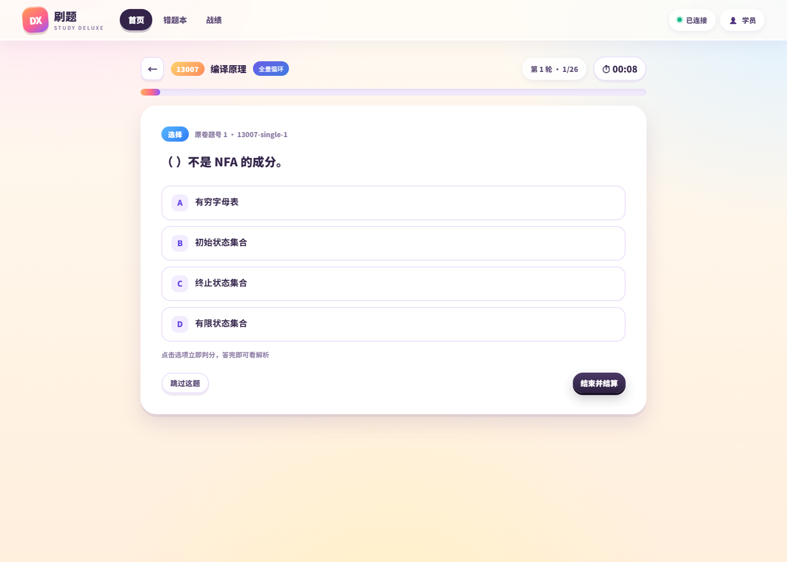

# 刷题 DX · 四科客观题

> 全量无限循环 + 随机组卷刷卷，maimai DX 风格的结算界面。
> 题库来自《四科模拟试卷 · 纠错解析与挖空版》，只收**客观题**，按科目拆分，已按勘误表修正答案。

**在线体验**：

- 一体站（前端 + API 同源）：<https://quiz.1551114.xyz/>
- GitHub Pages（静态前端，自动连线上 API）：<https://happysoysaucemin.github.io/quiz-dx/>

- 前端仓库：<https://github.com/happysoysaucemin/quiz-dx>
- 题库仓库：<https://github.com/happysoysaucemin/quiz-dx-bank>

> Pages 上没有 Node 后端，页面会自动把 `apiBase` 指向线上 API（quiz.1551114.xyz）；断网或后端不可用时会退回本地模式（成绩、错题本存在浏览器 localStorage）。想强制纯本地用 `?noserver=1`。


## 特性

- **两种模式**
  - ♾️ **全量无限循环**：按科目把全部题目刷完，自动进入下一轮；一题一判，答错立刻看解析和勘误备注。
  - 🎲 **随机组卷刷卷**：按学科/题型配置抽题（填空、单选、判断），可限时；支持上一题、答题卡跳转、交卷结算。
- **分科**：13006 软件工程（实践）、13007 编译原理、13008 软件质量保证与测试、13014 高级语言程序设计（实践），也可以四科混排。
- **DX 风格结算**：达成率、D~SSS+ 评级、AC/WA/SK 计数、单卷 Rating、B20 刷题力、PLAY TIME，按评级换背景色，还原街机结算的观感。
- **错题本**：做错的题自动收录，答对后自动移除；支持「错题重练」一键成卷。
- **战绩**：分科进度、练习历史、B20 构成。
- **可分离部署**：前端是纯静态页面（无构建），后端是零依赖 Node 服务；`config.js` 里改一个地址就能跨域部署。
- **题库即数据**：`bank/` 是一组 JSON，可单独作为仓库托管到 GitHub Pages / jsDelivr / 对象存储。
- **离线可用**：连不上后端时自动降级为本地模式，成绩存在浏览器里，联网后自动补传。

## 截图

| 组卷配置 | 答题 |
| --- | --- |
|  |  |


## 快速开始

需要 Node.js 18+（推荐 20/22），无需 `npm install`。

```bash
# 在项目根目录
node server/server.mjs
# 或 Windows 双击 start.bat

# 浏览器打开
http://localhost:8787
```

默认行为：

- 静态页面：`web/` → `/`
- 题库 JSON：`bank/` → `/bank/`
- API：`/api/*`
- 数据：`server/data/db.json`（首次写入时自动创建）

### 只部署前端（静态站）

把 `web/`（以及 `bank/`，或把 bank 托管到别处）丢到任意静态托管即可，没有构建步骤：

1. 编辑 `web/js/config.js`：

```js
window.APP_CONFIG = {
  apiBase: 'https://quiz-api.example.com', // 后端地址，留空=同源
  bankBase: '',                            // 题库地址，留空=页面同级 ./bank/
  useServer: true,
};
```

2. 后端启动时设置允许的来源：

```bash
CORS_ORIGIN=https://your-frontend.example.com node server/server.mjs
```

> `bankBase` 也可以是完整 URL，例如
> `https://cdn.jsdelivr.net/gh/happysoysaucemin/quiz-dx-bank@main/`，前端会直接跨域拉取题库（后端静态服务已带 CORS，GitHub Pages/jsDelivr 本身也支持跨域）。

### 只部署后端（纯 API）

```bash
PORT=8787 DATA_DIR=/var/lib/quiz-dx node server/server.mjs
```

后端不依赖 `web/` 也能跑，但 `/` 会 404；它的职责只有 `/api/*`。

## 目录结构

```
刷题器/
├─ bank/                  # 题库 JSON（可独立成仓库托管）
│  ├─ index.json          # 科目索引 + 题量
│  ├─ 13006.json …        # 每科一个文件
│  └─ README.md           # 题库格式与托管说明
├─ web/                   # 纯静态前端（无构建）
│  ├─ index.html
│  ├─ css/…               # 基础样式 + 结算样式
│  └─ js/
│     ├─ config.js        # ★ 部署时只改这里
│     ├─ app.js           # 路由 / 答题 / 结算 / 错题本 / 战绩
│     ├─ api.js           # 后端客户端（带超时与降级）
│     ├─ rating.js        # 评分公式（与后端同源）
│     └─ …
├─ server/                # 零依赖 Node 服务
│  ├─ server.mjs          # HTTP + 静态托管 + API
│  ├─ lib/rating.mjs      # 与 web/js/rating.js 保持一致
│  ├─ lib/stats.mjs       # 服务端权威算分 / 错题本
│  ├─ lib/store.mjs       # JSON 持久化（原子写）
│  └─ data/               # 运行时生成
├─ tools/
│  ├─ build_bank.py       # 从资料 md 重新生成 bank/*.json
│  └─ check.mjs           # 题库 / 评分自检
├─ docs/
│  ├─ API.md
│  └─ screenshots/
└─ .github/workflows/pages.yml  # 可选：静态前端自动发布
```

## 题库

`bank/` 由 `tools/build_bank.py` 从

```
四科模拟试卷_纠错解析与挖空版/0x_*/…_纯客观题_解析版.md
```

解析生成（与该目录下 PDF 同源），只保留填空、单选、判断；已去重、纠错、重排题号。

当前共 **296 题**：

| 科目 | 填空 | 选择 | 判断 | 合计 |
| --- | ---: | ---: | ---: | ---: |
| 13006 软件工程（实践） | 16 | 30 | 18 | 64 |
| 13007 编译原理 | 27 | 26 | 24 | 77 |
| 13008 软件质量保证与测试 | 15 | 39 | 18 | 72 |
| 13014 高级语言程序设计（实践） | 15 | 58 | 10 | 83 |

重新生成 / 校验：

```bash
python tools/build_bank.py     # 需要 Python 3.9+
node tools/check.mjs           # 校验题库字段与前后端评分一致性
```

题库格式见 [bank/README.md](bank/README.md)。

## 结算与 Rating

口径参考 maimai DX，并在本项目里换算到试卷：

- **达成率** = 正确题数 ÷ 总题数 × 100%，显示 4 位小数。
- **评级**：SSS+ 100 / SSS ≥99 / SS ≥97 / S ≥93 / A ≥85 / B ≥75 / C ≥60 / D 其余。
- **试卷定数**：`1200 + 45 × (填空×1.2 + 选择×1 + 判断×0.8)`，题越多、填空越多，定数越高。
- **单卷 Rating** = `定数 ÷ 50 × F(达成率)`，其中
  `F(A) = A × 系数(A) ÷ (97 × 20)`，系数表照搬 maimai 的达成率阶梯（SSS+ 22.4 / SSS 21.6 / SS 21.1 / S 20.0 / A 16.8 / B 13.6 / C 8.0 / D 0）。
  所以 97% 恰好是 1.0 倍定数/50；循环模式因为即时给答案，单卷 Rating ×0.85 折算。
- **B20 刷题力** = 历史最佳 20 卷的单卷 Rating 之和（服务端计算，前端只展示）。

题目得分全部等权；填空题按「可接受答案」做归一化匹配（去空白/标点、支持括号内同义答案、支持包含关系），答错时循环模式可以点「判我对」自评改判。

## API

| 方法 | 路径 | 说明 |
| --- | --- | --- |
| GET | `/api/health` | 健康检查 |
| GET | `/api/profile?uid=` | 用户档案、统计、最近答卷、错题本 |
| POST | `/api/profile` | `{uid,nickname}` 改昵称 |
| POST | `/api/attempts` | `{uid,nickname,attempt}` 交卷（幂等，按 attempt.id 去重） |
| DELETE | `/api/wrongbook?uid=` | 清空错题本 |
| GET | `/api/leaderboard` | B20 排行（前 20） |

详见 [docs/API.md](docs/API.md)。

## 数据与安全

- 服务端把数据写在 `server/data/db.json`，原子替换写；默认最多保留每个用户 1000 条答卷。
- 没有账号密码体系：`uid` 是浏览器生成并保存在 `localStorage` 的随机 ID，**知道 uid 就能读写对应数据**。适合个人/小范围使用；公网部署请自行加反向代理鉴权或限制访问。
- 前端 `localStorage` 键：`dx.uid`、`dx.nick`、`dx.attempts`、`dx.wrong`、`dx.session`、`dx.lastResult`。

## 线上部署（server7）

当前生产环境：<https://quiz.1551114.xyz/>（Ubuntu 22.04 + nginx + systemd + Let's Encrypt）。

| 项 | 位置 / 值 |
| --- | --- |
| 代码目录 | `/opt/quiz-dx`（独立目录，与同机 huaxue 项目互不影响） |
| 数据目录 | `/var/lib/quiz-dx/db.json`（服务以 `www-data` 运行，只可写这里） |
| systemd | `quiz-dx-api.service`（`/etc/systemd/system/`）+ `/etc/quiz-dx/env` |
| 监听 | `127.0.0.1:8787`（只对本机 nginx 开放） |
| nginx | `/etc/nginx/conf.d/quiz-dx.conf`：`/` 静态、`/api/` 反代、`/bank/` 题库 |
| 证书 | `certbot --nginx -d quiz.1551114.xyz`，自动续期 |

常用运维命令：

```bash
systemctl status quiz-dx-api      # 状态
systemctl restart quiz-dx-api     # 重启
journalctl -u quiz-dx-api -f      # 日志
nginx -t && systemctl reload nginx
```

更新代码（在服务器上）：

```bash
cd /opt/quiz-dx && git pull --ff-only
systemctl restart quiz-dx-api      # 只在 server/ 改动时需要
```

## 部署到 GitHub Pages（可选）

`.github/workflows/pages.yml` 会把 `web/` + `bank/` 一起发布到 Pages。首次使用：

1. 把仓库推到 GitHub，Settings → Pages → Source 选 GitHub Actions；
2. `web/js/config.js` 里 `API_ORIGIN` 指向后端地址（`*.github.io` 会自动使用它）；
3. push 到 `main` 即可。

题库也可以单独拆成一个仓库（已发布：[happysoysaucemin/quiz-dx-bank](https://github.com/happysoysaucemin/quiz-dx-bank)）：直接把 `bank/` 里的文件推到仓库根目录，`bankBase` 指向 `https://cdn.jsdelivr.net/gh/happysoysaucemin/quiz-dx-bank@main/`。

## 说明

题库内容整理自本机《四科模拟试卷_纠错解析与挖空版》，仅用于个人复习；答案以资料中的「修正版 / 勘误表」为准。题目里带 `📌 勘误` 的解析来自原资料的纠错说明。
